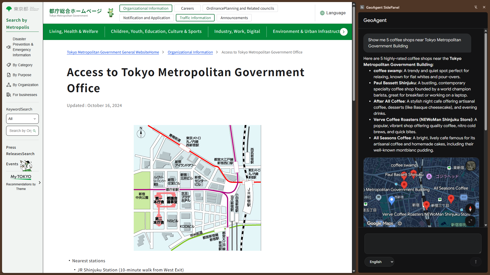
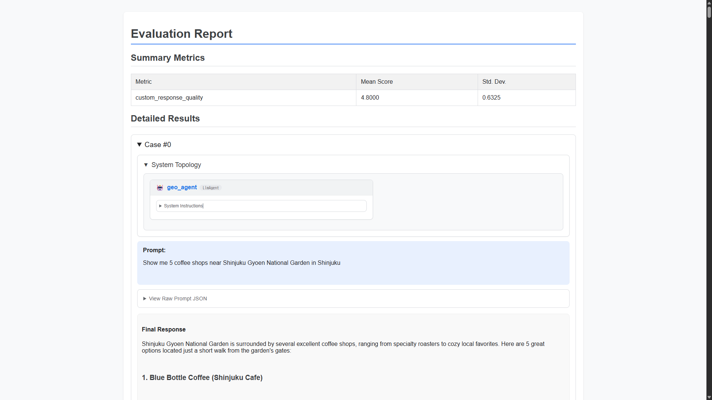
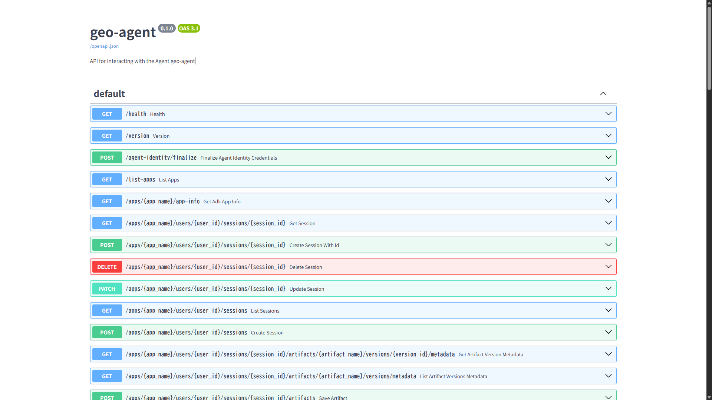
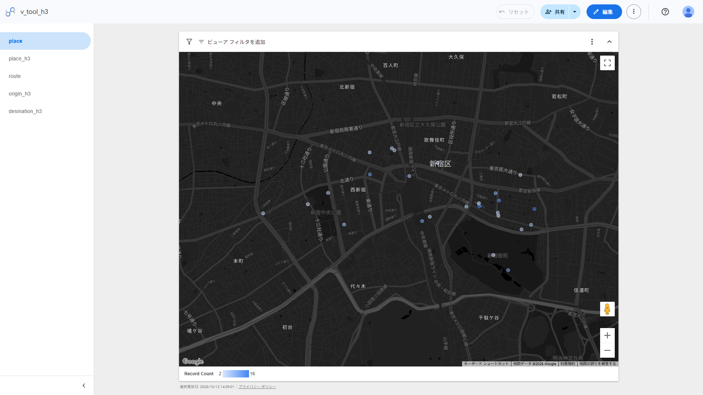
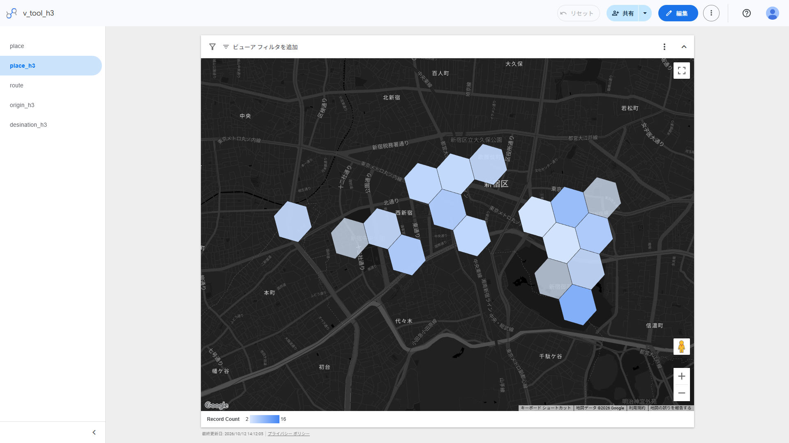

# geo-agent

Built with agents-cli, googlemaps/a2ui, and Google Cloud Agent Stack:
- **[agents-cli](https://github.com/google/agents-cli)**: The CLI and skills that turn any coding assistant into an expert at creating, evaluating, and deploying AI agents on Google Cloud.
- **[googlemaps/a2ui](https://github.com/googlemaps/a2ui)**: The A2UI implementation for the Maps Agentic UI Toolkit.
- **[googlemaps-samples/a2ui](https://github.com/googlemaps-samples/a2ui)**: Samples for the A2UI implementation for the Maps Agentic UI Toolkit.
- **[Uber H3 Spatial Indexing](https://h3geo.org/)**: Discretizes physical geography into hexagonal grid cells (Resolutions 0–15) for deterministic spatial clustering and OD corridor routing.
- **[Google Maps MCP & Places API (New)](https://developers.google.com/maps/ai/grounding-lite)**: Dual-layer grounding combining Grounding Lite MCP for LLM tool search with Places API (New) Pro-tier to eliminate map hallucinations and deliver verified place details.




## Project Structure

```
geo-agent/
├── app/                       # Core agent backend (FastAPI & Google ADK)
│   ├── agent.py               # Main agent logic & MAUI bundle definition
│   ├── agent_executor.py      # MAUI agent executor integration
│   ├── fast_api_app.py        # FastAPI backend server with A2A & spatial routes
│   ├── localization_service.py # Place localization & Pro-tier metadata service (Places API New)
│   ├── spatial/               # Uber H3 hierarchical spatial indexing & caching
│   │   ├── __init__.py
│   │   └── h3_service.py      # H3 service (lat/lng to cell, k-ring, A2UI enrichment)
│   └── app_utils/             # App utilities, A2A endpoints, and services
│       ├── a2a.py             # A2A protocol utilities
│       └── services.py        # Shared service helpers
├── client/                    # Client applications
│   └── web/react/             # React web client with A2UI renderer & language selector
├── artifacts/                 # Eval outputs (auto-generated)
│   ├── traces/                # Raw agent traces (JSON)
│   └── grade_results/         # Graded eval results (JSON + HTML)
├── assets/                    # Screenshots and diagrams for documentation
├── deployment/                # Deployment infrastructure (Terraform)
├── tests/                     # Unit, integration, and evaluation datasets
│   └── eval/datasets/         # Eval datasets (e.g., basic-dataset.json)
├── agents-cli-manifest.yaml   # agents-cli project manifest
├── Dockerfile                 # Backend container definition for Cloud Run
├── GEMINI.md                  # AI-assisted development guide
└── pyproject.toml             # Project dependencies and packaging
```


## Requirements

Before you begin, ensure you have:
- **uv**: Python package manager (used for all dependency management in this project) - [Install](https://docs.astral.sh/uv/getting-started/installation/) ([add packages](https://docs.astral.sh/uv/concepts/dependencies/) with `uv add <package>`)
- **agents-cli**: Agents CLI - Install with `uv tool install google-agents-cli`
- **Google Cloud SDK**: For GCP services - [Install](https://cloud.google.com/sdk/docs/install)


## Quick Start

Install `agents-cli` and its skills if not already installed:

```bash
uvx google-agents-cli setup
```

Install required packages:

```bash
agents-cli install
```

Test the agent with a local web server:

```bash
agents-cli playground
```

Run code quality


```bash
agents-cli lint
```

```bash
uv run pytest tests/unit tests/integration
```

You can also use features from the [ADK](https://adk.dev/) CLI with `uv run adk`.

Evaluate agent behavior:

```bash
agents-cli eval run
```

> **Test cases** are defined in [`tests/eval/datasets/basic-dataset.json`](tests/eval/datasets/basic-dataset.json).
> **Evaluation results** (traces) are saved to [`artifacts/traces/`](artifacts/traces/).



### Agent Configuration & Local Development

#### 1. Configure the Default Agent (`.env`)

Set `A2UI_DEFAULT_AGENT` in `.env` to choose your default agent mode:

```bash
A2UI_DEFAULT_AGENT=TEMPLATE
```

#### 2. Start the MAUI Agent Backend

```bash
uv run python -m app.fast_api_app
```

#### 3. Start the React Web Client

```bash
cd client/web/react
npm install
npm run dev
```

## Commands

| Command              | Description                                                                                 |
| -------------------- | ------------------------------------------------------------------------------------------- |
| `agents-cli install` | Install dependencies using uv                                                         |
| `agents-cli playground` | Launch local development environment                                                  |
| `agents-cli lint`    | Run code quality checks                                                               |
| `agents-cli eval`    | Evaluate agent behavior (generate, grade, analyze, and more — see `agents-cli eval --help`) |
| `uv run pytest tests/unit tests/integration` | Run unit and integration tests                                                        |
| `agents-cli deploy`  | Deploy agent to Cloud Run                                                                   |
| [A2A Inspector](https://github.com/a2aproject/a2a-inspector) | Launch A2A Protocol Inspector                                                       |

## 🛠️ Project Management

| Command | What It Does |
|---------|--------------|
| `agents-cli scaffold enhance` | Add CI/CD pipelines and Terraform infrastructure |
| `agents-cli infra cicd` | One-command setup of entire CI/CD pipeline + infrastructure |
| `agents-cli scaffold upgrade` | Auto-upgrade to latest version while preserving customizations |

---

## Development

Edit your agent logic in `app/agent.py` and test with `agents-cli playground` - it auto-reloads on save.

## Deployment

#### 1. Deploy the MAUI Agent Backend (`geo-agent`)

##### 1.1 Set Up Infrastructure (Terraform)

Provision the Google Cloud infrastructure (Cloud Run, GCS telemetry logs bucket, BigQuery dataset/views, and IAM roles) using Terraform via `agents-cli`:

```bash
# Set your GCP project
gcloud config set project <your-project-id>

# 1. Enhance project infrastructure scaffolding (preview -> apply)
agents-cli scaffold enhance --deployment-target cloud_run --bq-analytics --dry-run
agents-cli scaffold enhance --deployment-target cloud_run --bq-analytics

# 2. Provision single-project infrastructure via Terraform (plan preview -> apply)
agents-cli infra single-project --project <your-project-id>
agents-cli infra single-project --apply --project <your-project-id>

# 3. Upgrade project to latest CLI template version (preview -> apply)
agents-cli scaffold upgrade --dry-run
agents-cli scaffold upgrade
```

##### 1.2 Deploy Agent Application

Deploy the application container and code:

```bash
# Deploy using gcloud run deploy (explicitly request-based billing & min 0 instances)
gcloud run deploy geo-agent \
  --source . \
  --project <your-project-id> \
  --region <your-region> \
  --cpu-throttling \
  --min-instances 0 \
  --max-instances 10 \
  --memory 4Gi \
  --cpu 1
```

##### 1.3 Allow Public Invocation

Allow public invocation (required for client access):

```bash
gcloud run services add-iam-policy-binding geo-agent \
  --region <your-region> \
  --project <your-project-id> \
  --member="allUsers" \
  --role="roles/run.invoker"
```

#### 2. Deploy the React Web Client (`geo-agent-web`)

Deploy the web client to Cloud Run:

```bash
cd client/web/react

gcloud run deploy geo-agent-web \
  --source . \
  --project <your-project-id> \
  --region <your-region> \
  --allow-unauthenticated \
  --cpu-throttling \
  --min-instances 0 \
  --max-instances 10 \
  --memory 512Mi \
  --cpu 1
```


To add CI/CD and Terraform, run `agents-cli scaffold enhance`.
To set up your production infrastructure, run `agents-cli infra cicd`.

#### 3. Verify the Deployed API

After deployment, the interactive API documentation (Swagger UI) is available at:

```
https://<your-cloud-run-service-url>/docs
```

**Example endpoint — Uber H3 Spatial Index (`/api/spatial/h3-info`):**

This endpoint returns the [Uber H3](https://h3geo.org/) hexagonal grid cell information (cell index, neighbors, etc.) for a given latitude, longitude, and resolution. It is useful for verifying that the spatial indexing layer is functioning correctly after deployment.





## Observability

Built-in telemetry exports to Cloud Trace, BigQuery, and Cloud Logging.

### 1. Cloud Trace & Prompt-Response Logging (`completions` / `completions_view`)

Prompt-response completions are exported via OpenTelemetry to Cloud Storage and joined with Cloud Logging in BigQuery via the pre-built `completions_view`:

```bash
PROJECT_ID="your-dev-project-id"
PROJECT_NAME="your-project-name"

# Check for telemetry files in GCS
gsutil ls gs://${PROJECT_ID}-${PROJECT_NAME}-logs/completions/

# Query telemetry in BigQuery
bq query --use_legacy_sql=false \
  "SELECT * FROM \`${PROJECT_ID}.${PROJECT_NAME}_telemetry.completions\` LIMIT 10"

# Query and display all deterministic A2UI JSON payloads (set_model_response) from BigQuery
bq query --use_legacy_sql=false --location=US --max_rows=1000 --format=prettyjson \
  "SELECT 
     p.arguments AS a2ui_data 
   FROM \`${PROJECT_ID}.${PROJECT_NAME}_telemetry.completions\`, 
   UNNEST(parts) AS p 
   WHERE p.name = 'set_model_response'"
```


### 2. BigQuery Agent Analytics (`agent_events`)

When `BQ_ANALYTICS_DATASET_ID` is configured, structured ADK agent events, tool calls, and token usage are streamed directly via `BigQueryAgentAnalyticsPlugin`.

#### Example Queries
Replace `YOUR_PROJECT_ID` and `YOUR_AGENT_NAME` accordingly.

Recent events:

```sql
SELECT *
FROM `YOUR_PROJECT_ID.YOUR_AGENT_NAME_telemetry.agent_events`
ORDER BY timestamp DESC
LIMIT 100;
```

Tool calls and errors:

```sql
SELECT
  timestamp,
  JSON_VALUE(content, '$.tool') AS tool_name,
  JSON_VALUE(content, '$.args') AS tool_args,
  status,
  error_message
FROM `YOUR_PROJECT_ID.YOUR_AGENT_NAME_telemetry.agent_events`
WHERE event_type IN ('TOOL_COMPLETED', 'TOOL_ERROR')
ORDER BY timestamp DESC;
```

LLM token usage:

```sql
SELECT
  agent,
  JSON_VALUE(attributes, '$.model') AS model,
  SUM(CAST(JSON_VALUE(attributes, '$.usage_metadata.prompt') AS INT64)) AS total_prompt_tokens,
  SUM(CAST(JSON_VALUE(attributes, '$.usage_metadata.completion') AS INT64)) AS total_completion_tokens
FROM `YOUR_PROJECT_ID.YOUR_AGENT_NAME_telemetry.agent_events`
WHERE event_type = 'LLM_RESPONSE'
  AND JSON_VALUE(attributes, '$.usage_metadata.prompt') IS NOT NULL
GROUP BY agent, model;
```

### 3. Looker Studio Dashboard

The BigQuery telemetry data can be visualized in [Looker Studio](https://lookerstudio.google.com/) by connecting it to the `agent_events` or `completions_view` tables in your project.




## A2A Inspector

This agent supports the [A2A Protocol](https://a2a-protocol.org/). Use the [A2A Inspector](https://github.com/a2aproject/a2a-inspector) to test interoperability.
See the [A2A Inspector docs](https://github.com/a2aproject/a2a-inspector) for details.